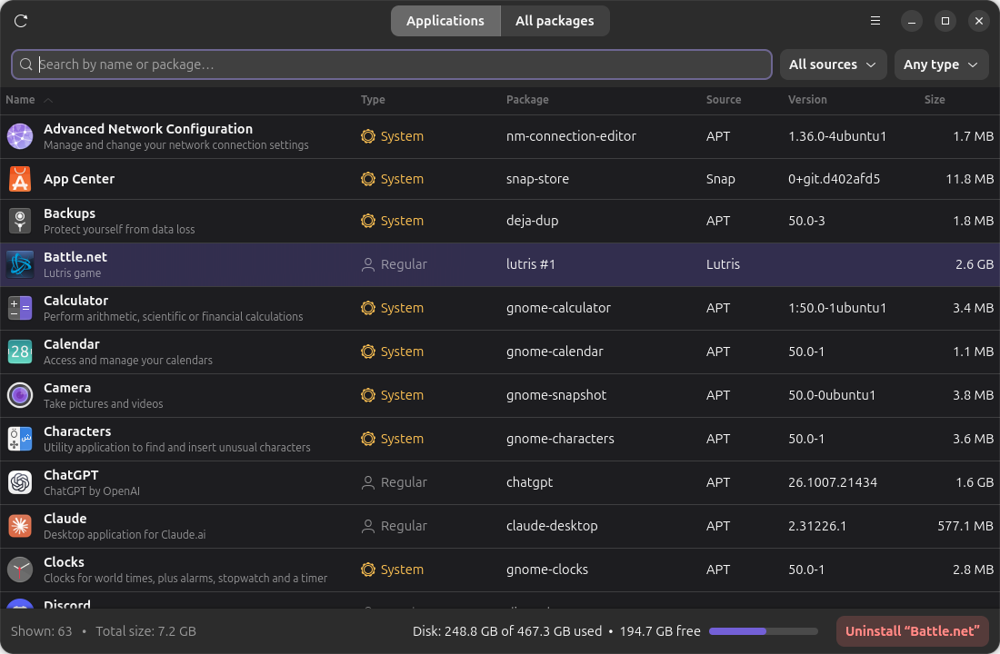
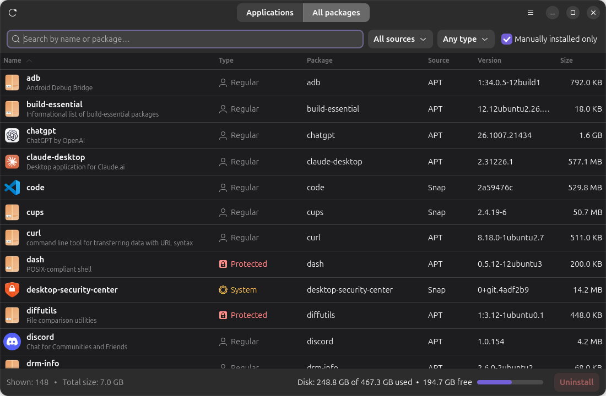
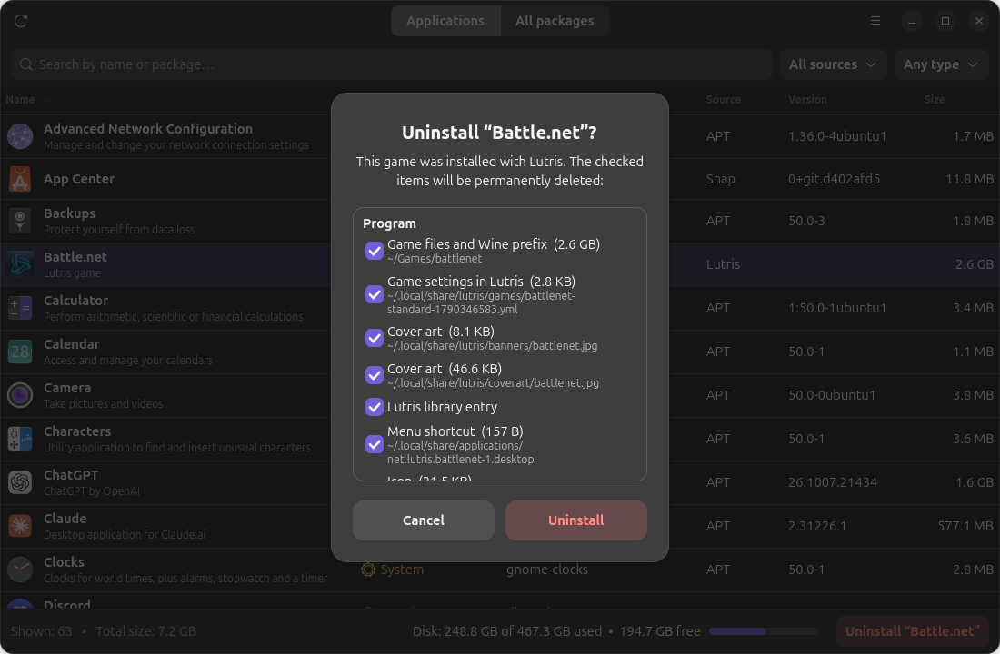

# Installed Apps

**English** | [Русский](README.ru.md)

A simple app manager for Ubuntu — like **"Add or Remove Programs" in Windows**.
See everything installed on your computer in one list and uninstall what you don't need in a couple of clicks.



## Features

- **Every source in one list:** APT (deb), Snap, Flatpak, Lutris games, and apps installed manually
  into your home folder (AppImages, script installers, etc.).
- **Icon, version and size** of every app; search, filters and sortable columns.
- **Disk usage** at the bottom: how much space is used and free.
- **Keeps your system safe.** Every app is labeled:
  | Type | Meaning |
  |---|---|
  | 🔒 Protected | Required by the system (kernel, desktop, Files, Settings…). Removal is blocked |
  | ⚙ System | Part of the standard Ubuntu install. Can be removed, with a warning |
  | 👤 Regular | Installed by you — safe to remove |

  Before removing a deb package, the app checks **what else would be removed along with it** and blocks
  the removal if any protected package is affected. You can unlock this in the ☰ menu if you really need to.
- **Manually installed apps:** finds the program folder, menu shortcut, icons, systemd background services
  and autostart entries, and shows the list with sizes before deleting. Your data and settings are kept by default.
- **"All packages" tab** — every package on the system, with a "manually installed only" filter.
- **English and Russian UI** — follows your system language; switch it in ☰ → Language.

<p>
  
  
</p>

## Requirements

- Ubuntu 24.04 or newer (or another Debian-based distro with libadwaita 1.5+)
- Python 3, GTK 4, libadwaita — the installer adds them if they are missing

## Install

```bash
git clone https://github.com/vlgn/ubuntu-app-manager.git
cd ubuntu-app-manager
./install.sh
```

Then open **Installed Apps** from the app menu, or run `app-manager`.
The app is installed for your user only (into `~/.local`); only the dependencies need `sudo`.

To remove the app itself:

```bash
./uninstall.sh
```

## How it works

- Lists come from `dpkg-query`, `snap list`, `flatpak list` and the `.desktop` files of the app menu.
- Removal uses `apt-get remove` / `snap remove` (via `pkexec` — the system asks for your password),
  `flatpak uninstall`, and for manual apps and Lutris games — deleting their files in your home folder.
- Nothing is removed without a confirmation dialog listing exactly what will be deleted.
- The app never deletes shared folders (`~/Documents`, `~/.config`, `~/.local/share`, …) as a whole,
  and never touches anything outside your home folder except through the package manager.

## License

MIT
